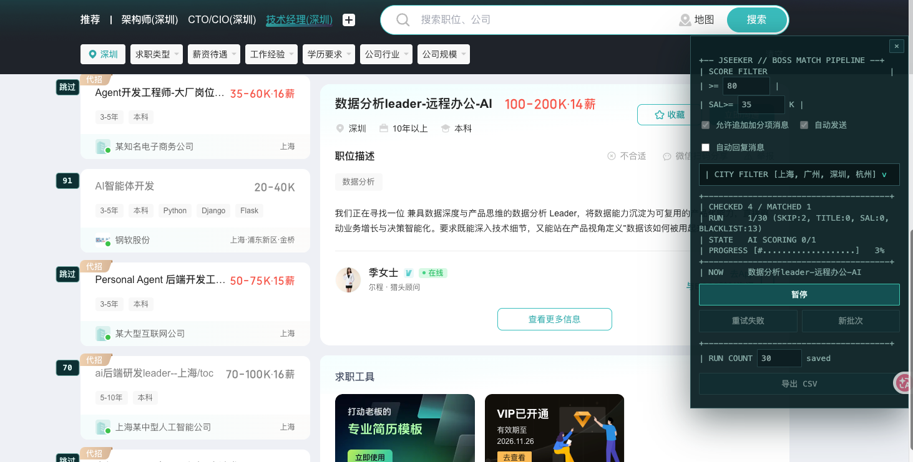
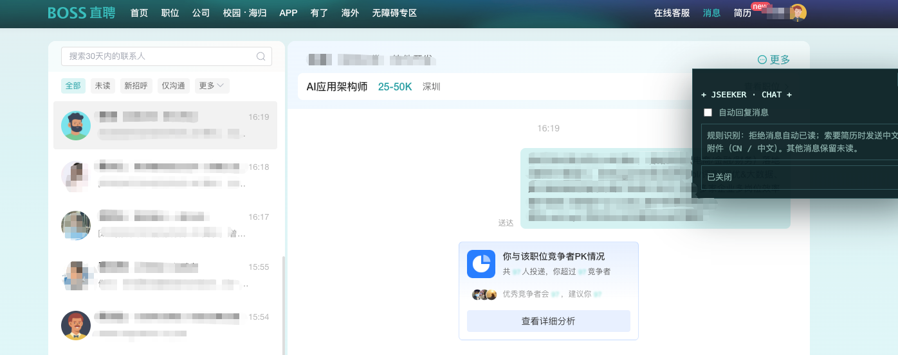
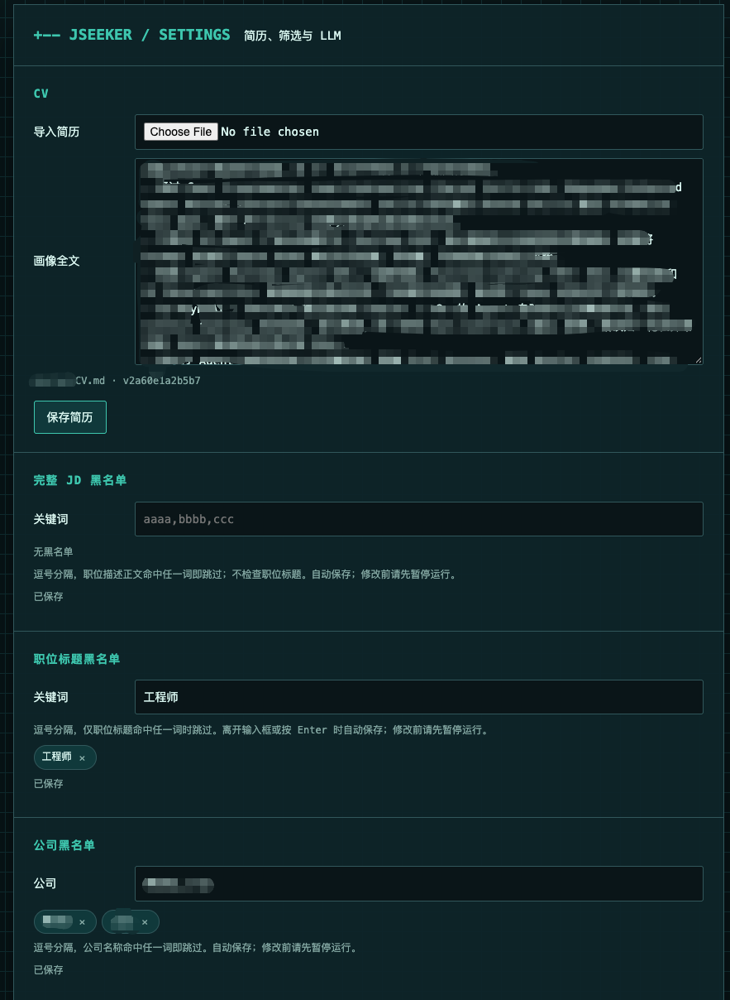
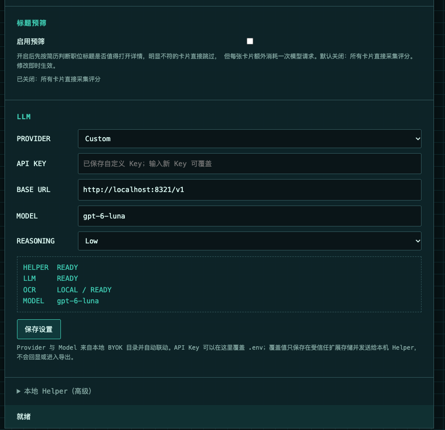

# JSeeker · Job Match

**English** | [简体中文](README.zh-CN.md)

A Chrome / Brave Manifest V3 extension that collects job descriptions from BOSS Zhipin and Liepin search results, fills garbled fields with local screenshot OCR, and asks an LLM to score each job against your CV on a 0–100 scale. Jobs above the threshold enter the contact/application stage automatically.

See [CONTRIBUTING.md](CONTRIBUTING.md) for the architecture and for a step-by-step guide to adding another job site.

## Supported sites

| Site | Hosts | Status |
| --- | --- | --- |
| BOSS Zhipin | `zhipin.com` | Supported |
| Liepin | `liepin.com`, `c.liepin.com` | Supported |
| Glassdoor | `glassdoor.com` | Planned — see [Roadmap](#roadmap) |
| Indeed | `indeed.com` | Planned — see [Roadmap](#roadmap) |

## Screenshots

**Live match scores in the side panel.** Every card shows the LLM score; jobs below the threshold or blocked by a blacklist are marked. The panel controls the threshold, city selection, run size, and CSV export.



**Auto-reply on the BOSS chat page.** Clear rejections are opened and marked read; CV requests can send a Chinese attachment automatically, without calling the LLM.



**Settings: CV and blacklists.** Import a Markdown CV, see the redacted profile version, and maintain separate JD, job-title, and company blacklists.



**Settings: LLM and runtime status.** Choose a BYOK provider and model, override the API key locally, and check Helper / LLM / local OCR readiness before starting.




## Installation

```bash
npm ci
npm run build
npm run helper:build
```

Enable developer mode at `brave://extensions` and load the project's `dist/`. Do not load the `extension/` source directory: its module and CSS imports require a build first. After changing code, rerun `npm run build`, click Reload on the extension, and refresh the BOSS page. If the side panel does not appear, click the toolbar JSeeker icon → **Open match panel** to restore a hidden panel or inject the script into an already-open search list page.

## Local CV profile

The repository never stores a real CV. Two files are involved:

- `extension/profile.example.json` — committed, synthetic sample data used only to document the profile shape. It is flagged with `"is_example": true` and the Settings page warns you to import your own CV.
- `extension/profile.local.json` — your real CV, machine-local, listed in `.gitignore`, written with mode `0600`. `npm run build` copies it into `dist/` only when it exists.

Import a Markdown CV from the command line:

```bash
npm run import-cv -- /path/to/cv.md
```

Or paste/upload it on the extension's Settings page. In both paths, phone numbers, email addresses, and personal links are removed by `redactCV` before the text is stored or sent to a model.

On first run the extension seeds `profile` from `profile.local.json` when present, otherwise from `profile.example.json`. **Import your own CV before starting a real run**, or the model will score against the example.

## `.env`

`npm run helper` reads `.env` from the repository root first, so same-named environment variables from the terminal or host tools do not override project settings:

```text
OPENAI_API_KEY=<redacted>
OPENAI_BASE_URL=<redacted>
```

Optional default model:

```text
OPENAI_MODEL=<model id>
```

When no default model is set, the Helper detects the local provider catalog from the Base URL and uses the same default as the Settings page (for example DeepSeek's `deepseek-flash`). Custom or unrecognized Base URLs still require an explicit model.

Optional model timeout, default 120 seconds:

```text
OPENAI_TIMEOUT_MS=120000
```

Optional model output budget, default 3000 tokens:

```text
OPENAI_MAX_TOKENS=3000
```

Real E2E tests use the `.env` credentials by default. The API key is used only inside the Helper process and never enters extension pages, `dist/`, CSV/JSON exports, or logs. The build script checks that `dist/` does not accidentally contain the key value.

Start the Helper:

```bash
npm run helper
```

The Helper appends the complete JD of every scoring request to `data/logs/jd-items.jsonl` (one JSON object per line, including time, model, and the job fields). It keeps appending across restarts; override the path with `JSEEKER_JD_LOG_PATH` in `.env`. The log contains neither the CV nor the API key, and the path is printed at startup. Jobs skipped by a blacklist and therefore never sent to the Helper are not written to this log.

On first use the extension pairs with the local Helper automatically; no token copying is required. The Helper only allows pairing from an extension ID derived from this project's `dist/` or `extension/` path, and verifies a machine-local pairing credential written into a private extension resource at build time (the root `.helper-pairing-key` and the generated `helper-pairing.json` are both `0600`, not committed to Git, and not exposed to web pages). Requests are still validated with a token and re-pair automatically when the token changes. The token lives in a local `0600` file and in trusted extension storage; it is not included in build output. Restart the Helper after updating this feature. Older Helpers or unusual install paths can still enter the connection token manually under **Local Helper (advanced)**. Generated pairing credentials are machine-local only; exclude them when distributing the project and rebuild on the target machine.

## BYOK Provider and Model

The Settings page reads [llm-provider-catalog.json](extension/llm-provider-catalog.json):

- Lists Chat Completions, OpenAI Responses, and Anthropic Messages providers; OpenAI and Anthropic (Claude) are directly selectable.
- Selects the provider automatically when the Base URL matches the catalog.
- Updates Base URL and the model dropdown together when the provider changes.
- Falls back to `Custom / .env` when the Base URL matches nothing.
- REASONING can be Auto (low for GLM 5.3, provider default for other models), Provider default (send no reasoning effort), or Low (always send low reasoning effort). Changing it invalidates old scores.

The API key input is editable directly:

- With no saved custom key, leave it empty to use the key the Helper reads from `.env`.
- Entering a new key and saving stores it as a local override in trusted extension storage.
- The input never echoes a saved value; it uses a password type and a status placeholder.
- After a custom key is saved, saving with an empty field keeps it; entering a new key replaces it.
- Switching provider or Base URL clears the previous provider's local key so credentials are never sent to another service.

Clicking **Save settings** checks the Helper and model configuration and updates the READY / ERROR status above, then syncs the result to any open match panel. The panel also re-reads the configuration before each start.

Choosing a provider that does not match `.env` uses that provider's Base URL. Changing provider, Base URL, or model marks old LLM scores as stale.

## Main workflow

1. Use BOSS's native city, title, and job filters on the BOSS list page.
2. The right-hand panel opens by default and provides the score threshold, major-city multi-select, run size, start/pause, retry-failures, new-batch, and CSV export controls.
3. After clicking **Start**, jobs in the list that have not been processed yet are collected serially.
4. Local OCR is enabled by default and needs no configuration in the main UI.
5. The LLM returns a match score, which is rendered directly on the job card on the left.
6. Jobs above the threshold automatically open the **Chat now** entry point without per-job confirmation. Bonus-item messages are submitted only when **auto-send** is enabled separately.
7. Scored and contacted jobs are persisted by `job_id` and reused; they are never collected or applied to twice.
8. If a card's location does not match the selected cities, it is skipped without opening the JD, calling OCR/LLM, or contacting anyone.
9. **JD blacklist** and **company blacklist** in Settings accept comma-separated keywords (for example `outsourcing,on-site,sales`). Saved lists render as single-line tags with a `×` to remove and auto-save. A job is skipped when its title, JD, or OCR-supplemented text matches the JD blacklist, or its company name matches the company blacklist. English matches are case-insensitive. Skipped jobs are not scored, not contacted, and do not consume the run quota; cards and the side panel mark them. When a BOSS card title already matches the JD blacklist, the skip is recorded without opening the detail, running OCR, or waiting for the detail interval; otherwise the full JD is still checked. Clearing an input cancels that blacklist, and jobs that were only title-checked can be collected again on the next run. Pause the run before editing.
10. **Title pre-screen** in Settings is off by default: every card opens its detail for collection and scoring. When enabled, each card first makes one LLM request against the CV; clearly unsuitable titles are skipped without opening the detail or scoring. The toggle takes effect immediately.
11. The side panel can be hidden; the `J` button on the right edge restores it.
12. BOSS adds **Auto-reply messages** (off by default). When checked, it clicks **Unread** on `/web/geek/chat`, and locally-classified clear rejections / unsuitable messages are opened automatically. When a message explicitly asks for a CV, it verifies the conversation counterpart and latest inbound message, then clicks **Send resume** → Chinese attachment → **Send**. It does not call the LLM; other messages stay unread. A Chinese attachment name must contain a standalone `CN` / `zh-CN` / `Chinese` marker, or `中文` / `简体` (for example `Sample-CV-cn.pdf`); when none is found or several Chinese attachments exist, the window is left open for manual selection. Send attempts are persisted for deduplication and are not retried automatically when the result is unconfirmed. Jobs with an existing resume-send/application record are skipped. Hidden tabs wait; manual interaction with the chat area pauses processing for that page, and toggling the checkbox resumes it. The chat page offers the same toggle and status without depending on the Helper or model configuration; only one chat page processes at a time, and bonus-draft handling yields automatically.

The BOSS chat page can also be started from the toolbar JSeeker icon → **Auto-reply messages**, without opening the side panel first. Pages that are already open but lack the chat script are injected automatically. Opening the popup during a run shows **Stop auto-reply**; after a manual pause, the popup shows **Auto-reply messages** again and clicking it resumes. After updating, reload the built `dist/` extension on the extension management page.

The chat side panel shows scan rounds, detected unread conversations, the rejection / CV-request / other classification, and processed counts. It displays a reason when a unique contact cannot be confirmed, the page structure is not recognized, or the resume window needs manual handling. BOSS unread counts messages, so the number may exceed the detected unread conversations.

## Model speed test

Run `npm run test:speed -- --help` for the options. By default it takes the latest collected JD and runs hello, real JD + CV returning only a score, the full production prompt in streaming mode, and the full production prompt in non-streaming mode, twice each. All default cases use `reasoning_effort: low`, temperature 0, and max_tokens 3000; the model and endpoint come from the specified configuration file.

Create a local `config.json` (do not commit credentials):

```json
{
  "llm_base_url": "http://localhost:8321/v1",
  "llm_model": "glm-5.3-flash",
  "llm_api_key_override": "YOUR_LOCAL_KEY"
}
```

The CV file is JSON with a `text` field. Run against a real collected JD and a local CV:

```bash
npm run test:speed -- --config /path/to/config.json --profile /path/to/profile.json \
  --jobs data/logs/jd-items.jsonl --job-id liepin:job:1986214177 \
  --repeats 2 --out artifacts/model-speed.json
```

Omit `--job-id` to take the latest JD from the log. Use `--cases production_stream_low,production_nonstream_low` to compare only the full scenarios, or adjust the budget with `--timeout-ms` and `--max-tokens`. Requests are serial and are not retried; the full scenarios reuse the production prompt and input truncation. The speed test sends the selected JD and CV to the configured model endpoint.

The JSON output records response headers, first event/reasoning/content, total latency, token usage, returned model, and validation results for each call; a Markdown summary is generated next to it. Credentials, the full CV, and complete model output are not included. Non-streaming cannot measure time-to-first-token; the report distinguishes HTTP success from a valid business result, and small samples, caching, and server load affect the comparison.

### LangSmith tracing

Set `LANGSMITH_TRACING=true`, `LANGSMITH_API_KEY`, `LANGSMITH_PROJECT`, and optionally `LANGSMITH_ENDPOINT` (default `https://api.smith.langchain.com`) in `.env`, then restart the Helper. Each `/evaluate` scoring call sends one LangSmith trace over OpenTelemetry OTLP, recording the model, latency, prompt version, input character count, retry count, score, conclusion, and provider-reported token usage. Traces contain no JD, CV, or API key. View them on the corresponding Project's Tracing page in LangSmith; the local Helper's existing timing logs remain available for request debugging.

The catalog prefers Flash/Lite/Mini models by default. The current DeepSeek setup recommends `deepseek-flash`. LLM input contains up to roughly 5200 characters of the JD; a CV under 16000 characters is sent in full, and only longer CVs are reduced to relevant excerpts. Output is compact JSON containing dimension scores, a short rationale, verbatim evidence, and separate hard-requirement status. Requirements without evidence (for example language ability) are marked unknown, are excluded from the capability score, and block automatic contact. GLM 5.3 models explicitly use `reasoning_effort: low` to avoid the default max-reasoning latency; rationales and evidence are concise while the full CV and independent non-technical eligibility requirements are preserved. The default output budget is 6000 tokens, and a truncated response is retried once with a larger budget. A scoring-version change invalidates old caches; after modifying it, restart the Helper, reload the extension, and refresh the page.

## Running

Run `./restart.sh` in the project directory. It stops the process holding the Helper port (default `17373`; `JSEEKER_PORT` is supported) and starts `npm run helper` in the foreground; press Ctrl+C to stop.

1. Open `https://www.zhipin.com/web/geek/jobs?city=101280600` and confirm the city and preset filters.
2. Click the toolbar JSeeker icon and open **Settings / Import CV**.
3. Import your CV and confirm the Helper, provider, and model status.
4. Return to BOSS and confirm the job list on the left and the ASCII control panel on the right.
5. Select one or more major cities under `CITY FILTER`; Shenzhen is the default.
6. Enter the run size; the value is saved as you type.
7. Set the score threshold and click **Start**.
8. During a run the same button becomes **Pause**.
9. Failed jobs can be reprocessed with **Retry failures**; successful data is never overwritten.
10. A new batch keeps the global score index and contact history. BOSS stops immediately when the search scope changes and keeps the original batch; restore the original filters or click **New batch** manually. It does not silently continue on the recommendation page. Liepin still archives the old batch and continues under the current filters. Manual pause, login verification, and site restrictions still pause the run.

The main UI does not show collected JD lists, dimension scores, manual review, OCR controls, or contacted-job details. CSV export includes score, eligibility, application status, contact time, and model source.

OCR screenshots hide the right-hand panel only while the target region overlaps it; the panel remains visible during local Vision recognition. You can also hide the whole side panel at any time and restore it with the `J` button on the right edge. When a model request times out or the model repeatedly returns invalid JSON, that job is recorded as a scoring failure and the run continues with other jobs; running again or **Retry failures** re-scores it.

## Persistence

Key local keys:

```text
job_index        Latest valid LLM score, reused by card badges and new batches
contacted_jobs   Jobs that reached the contact entry point; hidden and used for deduplication
run              Current batch's raw JDs, OCR evidence, scores, and application records
evaluation_cache
```

A cached record is reused only when all of the following match:

- `job_id`
- JD fingerprint
- CV version
- Provider / Base URL / Model / Prompt version

## Verification

```bash
npm test
npm run build
npm run test:auto-reply
npm run test:setup
npm run test:blacklist
npm run test:llm
npm run test:llm:mock
npm run test:ocr
npm run test:recovery
```

- `test:llm` reads the real `.env` by default, selects a provider/model from the BYOK catalog, and runs the full flow in an isolated Chromium instance.
- `test:setup` verifies automatic pairing, legacy-token recovery, side-panel injection/restoration, and the disabled side panel on the source directory in an isolated browser. It does not call a model or contact anyone. Set `JSEEKER_TEST_BROWSER` to a local Brave executable path if needed.
- `test:ocr` verifies the default local OCR path, PUA salaries, and downstream LLM scoring.
- `test:recovery` verifies wrong job IDs, failure records, and **Retry failures**.

Full regression:

```bash
npm run verify
```

Real-page acceptance uses a dedicated Brave profile with the site logged in; do not use an anonymous temporary profile. Before a real run, confirm the filters, run size, and score threshold. Automatic application clicks BOSS's **Chat now** entry point.

## Data safety

- Does not read cookies and does not call non-visible BOSS APIs.
- Removes temporary `securityId` parameters from job URLs.
- Removes phone numbers, email addresses, and personal links from the CV before it reaches the model.
- Treats JDs, CVs, and preferences as untrusted input.
- Does not auto-fill or send chat messages (the optional bonus-message and auto-reply features are explicit opt-ins).
- Real E2E output reports only status, model ID, and match score; it never prints credentials.

### Liepin flow

After loading the latest `dist/` extension, open the side panel on a logged-in `https://c.liepin.com/` home page, select cities, a score threshold, and a target count, then click **Start**. The background opens job detail tabs one by one, collects the JD, and scores it through the same Helper. Low scores continue the search; a passing score clicks **Chat** on the main job, confirms the result, closes the controlled detail tab, and returns to the list. **Continue chat** means the job was already contacted; it is not clicked again and does not consume a new target slot.

If a single job's hard requirements are pending verification or unmet, the JD is unreadable, or the model retries fail, the whole batch no longer pauses: the reason is saved, the job is skipped, and the search continues without consuming a target slot. CSV application-status and hard-requirement columns keep the reason. Hard requirements claimed by the model must be found verbatim in the current JD; English/CET-6 facts from the CV must not be treated as job requirements.

Both BOSS and Liepin panels offer an **Allow bonus-item message** checkbox, off by default and editable after pausing. When enabled, and a new contact succeeds while the JD clearly lists bonus items that match verbatim CV evidence (BOSS also supports existing conversations), the message "Multiple bonus items are also relevant, including…" is filled in, listing at most seven evidence-backed matches. Each item is checked against the JD, summaries are generated primarily from JD capabilities, and 1–3 CV excerpts may be combined; the summary need not appear verbatim in the CV. Every language, specific tool, team size, sandbox, or industry experience must have corresponding evidence and must not be invented just because the JD mentions it. The unsent draft tab is left open, the run switches back to the original list and continues, with no manual send or confirmation required. Existing text is never overwritten. If the conversation cannot be verified or the composer is abnormal, the reason is recorded, that bonus item is skipped, and the run continues; a successfully established contact is never retried, and its state is stored in the application record's `bonus_draft`. BOSS always performs first contact, continued contact, and bonus filling in a dedicated target-job tab; even if the site navigates the current page into chat, the original list is unaffected. When done, only the original list is activated: the list URL is not reopened, refreshed, or navigated back, preserving the original filters and scroll position. The original list's batch scope is re-verified before first contact and before sending. If the BOSS chat page does not respond within 30 seconds, the run records a timeout and continues; stale legacy draft-wait state is cleared after a refresh. The adjacent **auto-send** checkbox is off by default, requires the bonus-message option to be enabled, and can be changed and saved while paused. When off, only a draft is left; when on, it clicks Send automatically after verifying the target conversation and input content. Liepin closes the task detail tab after the bonus state is confirmed `sent`; drafts or unconfirmed sends keep it open, and other user tabs are never closed. A single-use authorization is persisted before clicking; an unconfirmed send is recorded as `send_unconfirmed`, is not retried, keeps the chat tab open, and the batch continues. After the first update, run `./restart.sh`, reload the extension, and refresh the job page so the new scoring hint and toggles take effect together. The extension verifies the Helper's running scoring-hint version and explicitly requires a restart on mismatch, preventing old prompts from omitting bonus items; when only BOSS bonus support or the confirmation flow changes, reloading the extension and refreshing the list is enough.

BOSS **Continue chat** and older local contact records can also receive bonus items: jobs in the current batch that are collected, have a valid score, and have no bonus draft yet are checked when **Start** is clicked, and existing conversations are opened without sending a new first greeting. Jobs whose draft was already generated or manually confirmed are not processed again. If the score does not return bonus items that can be verified against the CV, the panel shows the reason; passing the overall score alone does not trigger filling. BOSS first opens a dedicated target-job detail page and registers that tab before allowing it to click Chat; chat buttons inside the original list are never used for bonus processing. The site opening a new chat page or navigating within the detail tab is supported; recipients are never guessed from the general contact list. Ordinary job and chat pages that do not belong to the task are not operated automatically; existing text is never overwritten. Filling a draft triggers input and blur-save events; single-use authorization is persisted before sending, and unconfirmed sends are not retried. When the task completes, only the original list is activated; the chat page is kept to preserve the draft, and a successful send closes the task-owned tab.

A detail-load failure refreshes that controlled detail page once and retries. Model network errors, timeouts, invalid JSON, or malformed scores are retried once; if they still fail, a failure record is saved and the run continues. **Retry failures** reprocesses them, and contact records retain deduplication. Refreshing the list page during a run automatically restores tasks that have not clicked Chat yet; refreshing after an extension restart also resumes from the checkpoint. A Liepin refresh may reset the site's native job category; when the category differs from the original batch, the old batch is archived automatically and a new batch starts under the current category, while historical scores and contacts are retained.

On contact limits, login verification, unknown dialogs, job identity changes, or unconfirmed contact results, the whole flow still pauses and keeps the detail page. After manual handling, continue from the original list page; unconfirmed sends are never retried automatically, and a manual pause does not auto-resume after refresh. A BOSS search-scope change stops the run and requires manual filter confirmation and a new batch; Liepin scope switches can still start a new batch automatically. Historical scores and contacts are retained.

Contact restrictions are detected only from currently visible site dialogs, warnings, or toasts; the extension does not scan the entire JD or chat history. Messages distinguish **contact limit**, **too frequent**, and **verification required**, and include the site's original text; a membership-quota description is not treated as exhausted quota.

Liepin supports `/a/{id}.shtml` and `/job/{id}.shtml`, using `liepin:a:{id}` / `liepin:job:{id}` as deduplication keys and ignoring tracking parameters. Helper JSONL records include `site`, `job_id`, the canonical `url`, and the JD.

Fixture verification: `npm run build && npm run test:liepin`. It uses simulated pages and a mock model and does not replace real-site E2E acceptance in a logged-in Brave profile.

## Roadmap

- [ ] **Glassdoor** seeker (`glassdoor.com`): list/detail parsing, salary normalization, Easy Apply/contact flow.
- [ ] **Indeed** seeker (`indeed.com`): list/detail parsing, salary normalization, external-application handoff.
- [ ] Centralize the per-site registry so a new site touches one module instead of `sites.js`, `core.js`, `manifest.json`, `build.mjs`, and `content.js`.
- [ ] Generic contact redaction for English CVs (phone formats beyond CN mobile numbers).
- [ ] Document and test each new adapter against a sanitized DOM fixture before a live run.

Want to add one of these? Start with [CONTRIBUTING.md](CONTRIBUTING.md#adding-a-new-job-site), which walks through the adapter contract and the exact files to change.
